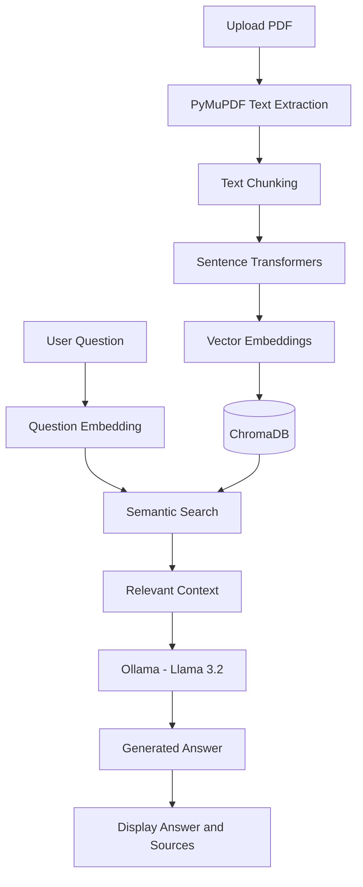

# DocuMind – AI-Powered PDF Question Answering System

DocuMind is an AI-powered PDF question-answering application built using **Retrieval-Augmented Generation (RAG)**. It allows users to upload a PDF document, ask questions about its contents, and receive context-based answers generated by a Large Language Model (LLM).

Instead of relying only on the model's pre-trained knowledge, DocuMind retrieves relevant information from the uploaded document and uses it to generate answers.

The application runs locally using Ollama, providing a document-based AI assistant through an interactive Streamlit interface.

## Features

- **PDF Upload:** Upload a PDF document through the web interface.
- **Text Extraction:** Extract text from PDF documents using PyMuPDF.
- **Intelligent Chunking:** Divide extracted text into smaller, overlapping chunks while preserving paragraph boundaries where possible.
- **Semantic Embeddings:** Convert text chunks and user questions into numerical vector representations.
- **Vector Database:** Store and retrieve document embeddings using ChromaDB.
- **Semantic Search:** Retrieve relevant document sections based on the meaning of a user's question.
- **LLM Integration:** Generate answers using the Llama 3.2 model through Ollama.
- **Source References:** Display retrieved document sections with source and page information.
- **Local Processing:** Run the language model locally through Ollama.

## Technologies Used

| Technology | Purpose |
|---|---|
| Python | Core application development |
| Streamlit | Interactive web interface |
| PyMuPDF | PDF text extraction |
| Sentence Transformers | Generate semantic text embeddings |
| all-MiniLM-L6-v2 | Text embedding model (384 dimensions) |
| ChromaDB | Persistent vector database |
| Ollama | Run the LLM locally |
| Llama 3.2 (3B) | Generate context-based answers |
| Requests | Communicate with the Ollama API |

## How the RAG Pipeline Works

DocuMind follows a Retrieval-Augmented Generation architecture consisting of two major stages: document indexing and question answering.

### 1. Document Indexing

1. **PDF Upload:** The user uploads a PDF document.
2. **Text Extraction:** PyMuPDF extracts text from the PDF pages.
3. **Text Chunking:** The extracted text is divided into smaller chunks with overlapping content to preserve context.
4. **Embedding Generation:** Sentence Transformers converts each chunk into a 384-dimensional vector.
5. **Vector Storage:** ChromaDB stores the generated embeddings along with the corresponding text and metadata.

### 2. Question Answering

1. **User Query:** The user enters a question in the Streamlit interface.
2. **Query Embedding:** The question is converted into a vector using the same embedding model.
3. **Semantic Retrieval:** ChromaDB searches for relevant document chunks using vector similarity.
4. **Context Construction:** The retrieved text is supplied to the language model as context.
5. **Answer Generation:** Ollama runs Llama 3.2 to generate an answer based on the retrieved information.
6. **Source Display:** The application displays the answer along with retrieved source information.

### RAG Architecture Diagram



## Installation Instructions

### Prerequisites

Install the following before running the application:

- Python 3.10 or later
- Git
- Ollama

### Step 1: Clone the repository

```bash
git clone https://github.com/YOUR-USERNAME/DocuMind.git
```

Navigate to the project directory:

```bash
cd DocuMind
```

### Step 2: Create a virtual environment

```bash
python -m venv .venv
```

Activate the environment on Windows:

```bash
.venv\Scripts\activate
```

### Step 3: Install dependencies

```bash
pip install -r requirements.txt
```

### Step 4: Install and configure Ollama

Download Ollama from:

https://ollama.com/

Pull the Llama 3.2 model:

```bash
ollama pull llama3.2:3b
```

Make sure Ollama is running before starting DocuMind.

The application communicates with Ollama through its local API:

```text
http://localhost:11434/api/chat
```

## How to Run the Application

After completing the installation:

1. Activate your virtual environment.
2. Make sure Ollama is running and the Llama 3.2 model is available.
3. Start the Streamlit application:

```bash
streamlit run app.py
```

4. Open the local URL displayed in your terminal, usually:

```text
http://localhost:8501
```

5. Upload a PDF document.
6. Wait for document indexing to finish.
7. Enter your question and receive an answer based on the document.

## Screenshots

Add screenshots of your actual running application in the `screenshots` folder.

### 1. DocuMind Home Page


### 2. PDF Upload and Document Indexing


### 3. Question and Answer Interface


### 4. Retrieved Sources


> Replace these screenshot paths with your actual screenshot filenames. GitHub will display the images automatically when the files exist in the repository.

## Project Structure

```text
DocuMind/
│
├── app.py                 # Streamlit user interface
├── rag_pipeline.py        # RAG pipeline implementation
├── evaluate_rag.py        # RAG evaluation interface
├── requirements.txt       # Python dependencies
├── README.md              # Project documentation
├── .gitignore             # Files excluded from Git
│
├── screenshots/           # Application screenshots
│
└── chroma_db/              # Persistent vector database (generated locally)
```

## Future Enhancements

- Support for multiple PDF documents.
- Conversation memory for follow-up questions.
- Hybrid search combining semantic and keyword retrieval.
- Improved retrieval and reranking techniques.
- Document summarization.
- Advanced RAG evaluation and performance measurement.

## Learning Outcomes

Through this project, I explored and implemented:

- Retrieval-Augmented Generation (RAG).
- Large Language Model integration.
- Text embeddings and semantic similarity.
- Vector databases and information retrieval.
- PDF processing and text chunking.
- Local LLM deployment using Ollama.
- Building interactive AI applications using Streamlit.

## Author

**Your Name**

GitHub: https://github.com/venkat-pokala/DocuMind.git

---

*DocuMind – Turning documents into an interactive AI knowledge assistant.*
